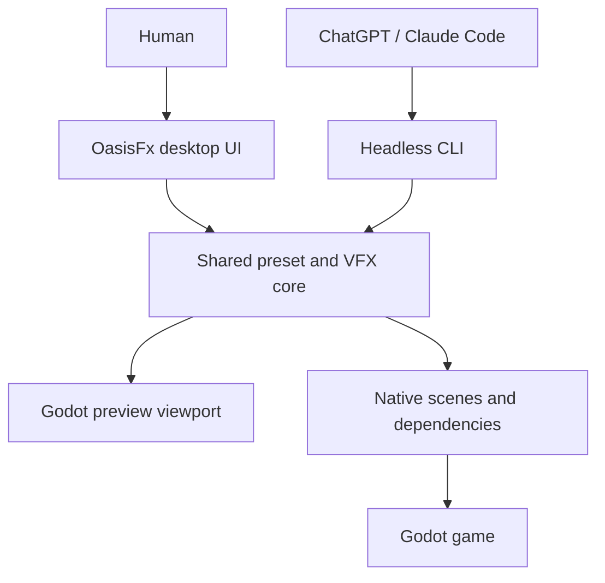

# OasisFx — Implementation Specification for Claude Code

> **Current direction (2026-10-15):** The owner wants **OasisFx as a standalone Windows desktop application built with Godot, plus a headless CLI using the same core**. This v1.1 direction supersedes the original EditorPlugin-first plan and the corresponding future-UI decisions in `AUDIT.md`. Keep the filename of this specification for existing links.
>
> **Current implementation:** `claude/cool-brown-hrne5t` at `4c6e7bf` implements Phase 1A under `addons/oasis_fx/`. An independent review reran the existing suite with Godot `4.7.2.stable.official.ed1daf0bf`: **41 passed, 0 failed, no script errors observed in that suite**. A separate deliberate runtime-error probe exposed a false-PASS bug in the test runner; fix this before accepting Phase 1A. No standalone UI or Windows export exists at this reviewed commit. Inspect the latest branch before coding; do not rebuild Phase 1A from scratch.

**Version:** 1.1 (standalone desktop direction; Phase 1A review follow-up)
**Target:** Godot / GDScript; Windows desktop app + platform-compatible headless CLI; first consumer: White Sahara
**Execution environment:** GitHub-hosted Claude Code cloud session (may be headless)
**Language:** Thai instructions; English identifiers, file names, code, tests, and schema keys
**Primary goal:** Build a reusable, AI-friendly toolchain that turns structured asset presets into validated, previewable, reusable Godot game assets.
**Priority:** VFX first; SFX, animation, and rigging in subsequent phases.

> **Important:** This document is a design brief, not a claim that these features exist. Claude MUST inspect the actual repository and installed Godot version before modifying code. Avoid inventing APIs or assuming a GUI/display is available in the cloud environment.

---

## 1. Executive decision

Build **a standalone Godot desktop application + versioned JSON presets + headless CLI/build/test pipeline**. Windows is the first desktop target. The user should launch OasisFx without opening Godot Editor or an existing game project.

- **Human workflow:** launch OasisFx → open/create a preset → edit and preview → save → export Godot assets.
- **AI workflow:** read the schema/docs → write JSON → invoke CLI → read diagnostics → fix/retry → integrate generated scenes into the game.
- **Shared core:** reuse the existing loader, validator, builder and generator in `addons/oasis_fx/src/core/`. Desktop controls must call these same functions, not duplicate validation or rendering logic.
- **Godot-native:** build the app UI with Godot Control nodes and preview with a dedicated SubViewport using the existing builder.
- **Headless-first foundation:** preserve Phase 1A CLI compatibility; Phase 1B improves the core and Phase 1C builds the desktop app. An EditorPlugin is an optional future adapter, not the Phase 1C deliverable.
- **Reusable:** keep the core self-contained in `addons/oasis_fx/`. The desktop shell lives separately under `app/`; do not hardcode White Sahara gameplay paths or autoloads.
- **Safe integration:** use designated output locations and explicit overwrite actions. Generated game assets must not require the OasisFx desktop UI at runtime.
- **Scope:** VFX first; SFX, animation and rigging remain later phases. No Tauri/Electron wrapper, full Spine replacement, DAW, AI model or hosted service is required.

### Definition of success for v0.1

A human can launch the exported Windows app, open a Fire Burst preset, adjust it, preview it, save it and export a usable `.tscn`. An AI can author and generate the same preset through the CLI without the GUI. The generated scene loads in a separate Godot game project, and tests detect validation, generation and script-runtime failures.

---

## 2. Context: White Sahara (verify against current repo)

A prior project status report (commit `5a4c870`, 2026-10-11) describes:

- Godot **4.7.2**, GDScript, 2D side-scrolling cozy fantasy cooking RPG.
- Existing AI art processing scripts under `tools/`, source art under `art/source/`, game-ready art under `assets/`.
- Character visual setup using **Skeleton2D + Polygon2D** (`mannequin.tscn`), including costume variants.
- Existing headless tests under `tests/`.
- No integrated audio playback system was found in that report.

These are **historical observations**. Inspect the current branch before relying on them. Preserve current art import pipelines, skeleton rigs, and test conventions. The OasisFx core and desktop app should work independently of the game.

**Visual direction:** Hand-painted / illustrated anime fantasy, chibi characters, warm painterly backgrounds; prioritize stylized hand-drawn-looking fire, ice, slashes, smoke, impacts, cooking sparks, and readable particles. Avoid low-resolution pixel-art effects unless explicitly requested.

---

## 3. Architecture



**Key principle:** both entrypoints use one parser/validator/builder/generator. Preview is made with the same builder as generated scenes.

### Existing foundation and planned desktop shell

```text
project.godot                         existing development host; desktop entry scene added in 1C
app/                                  planned in Phase 1C
  main.tscn
  main.gd
  ui/                                 preset controls and preview panel
  services/                           workspace/export adapters around the core
export_presets.cfg                    planned Windows export configuration; no secrets
addons/oasis_fx/
  README.md
  docs/
    preset_format.md
    cli.md
    ai_authoring_guide.md              add in Phase 1B
    desktop.md                        add in Phase 1C
  schemas/vfx.v1.schema.json
  presets/examples/fire_burst.vfx.json
  src/core/                           existing Phase 1A implementation
    oasis_fx.gd
    vfx_spec.gd
    validation_report.gd
    path_utils.gd
    preset_loader.gd
    preset_validator.gd
    vfx_builder.gd
    vfx_generator.gd
  src/runtime/                        Phase 1B, where needed
  cli/oasis_fx_cli.gd
  tests/
tools/render_preview.gd                existing development preview helper
```

Names under `app/` are proposed, not existing features. Preserve working paths and schema v1. `plugin.cfg` / EditorPlugin docks are not required for the desktop milestone.

### Where AI runs

- **Local Claude Code:** can invoke the local CLI when its environment has the project, compatible Godot binary and required permissions.
- **Cloud Claude Code:** needs a checked-out copy of the tool and a compatible Godot binary in that cloud environment. A Windows `.exe` on the user's PC is not automatically reachable or runnable from the cloud.
- GitHub stores source and changes; it is not the running application. No remote-control service is required.
- Keep the tested developer CLI invocation via `godot --headless --script ...`. Do not assume an exported game executable can run arbitrary `--script` source paths. A packaged-app CLI dispatcher may be added later, with explicit tests/documentation; it is not needed to preserve the existing developer CLI.

### Desktop workspace and export boundaries

- Packaged `res://` contains application resources and must be treated as read-only. Keep settings, imported/working presets and intermediate generated files under `user://` or a deliberately selected writable workspace.
- Phase 1A generator currently accepts sanitized `res://` / `user://` output directories. Preserve these protections. A desktop export adapter may stage under `user://` and copy validated outputs to the user's selected destination with explicit overwrite handling; do not simply permit arbitrary output paths in the core.
- A standalone app's `res://` is the app project, not the target game. Define a workspace-relative asset mapping; resolve texture references into that workspace and remap/package them into stable target-game `res://` paths at export. Do not silently interpret paths against a different game or claim the app has mounted it.
- Procedural Fire Burst must export as a standalone scene. For file-texture presets, include permitted dependencies with an explicit mapping/manifest or reject the export with an actionable error until that path is supported. A successful export must load in a separate target project without relying on the app's `user://` files.
- Do not copy the target game's scripts/settings or automatically modify gameplay code during asset export. Document where the user copies the resulting asset bundle.

Avoid adding an elaborate abstraction framework; implement one complete desktop Fire Burst workflow first.

---

## 4. v0.1 functional requirements: VFX Creator

### 4.1 Preset authoring

- Import JSON preset from file; validate version, required fields, types, numeric ranges, enums, and paths.
- Human-readable error messages with field paths (`emitters[0].lifetime_seconds` etc.).
- Stable IDs, descriptive names, tags, author notes, and schema version.
- Support multiple emitters per effect, each with its own color/scale/velocity/lifetime and optional texture.
- Effect-level duration, looping flag, playback speed, origin, and sorting/visibility settings.
- Particle shapes/texture modes limited to supported Godot features; unsupported features must produce a clear error, not be silently ignored.
- Starter presets: **Fire Burst**, **Ice Nova**, **Sword Slash**, **Cooking Success Sparkle**.

### 4.2 Godot scene generation

- Generate `.tscn` scenes with a predictable root node (prefer `Node2D` or an explicitly justified `GPUParticles2D` wrapper).
- Use built-in `GPUParticles2D`, `ParticleProcessMaterial`, `AnimationPlayer`, `Sprite2D`, `CanvasItemMaterial`, etc. only where needed.
- Handle one-shot vs looping effects, particle pre-processing if applicable, and automatic cleanup **without deleting parent game nodes**.
- Support effect lifetime and reliable restart/replay behavior.
- Keep the runtime scene independent from desktop application or EditorPlugin classes.
- Generated scenes must load successfully in Godot headless mode.
- Prefer generating editable native Godot resources/scenes rather than baking every effect to PNG.
- If export to sprite sheets/PNG sequences is added later, clearly document that **headless rendering may need a GPU/display**; do not promise it in v0.1.

### 4.3 Standalone visual editor (Phase 1C)

- Launch as a normal desktop app; Godot Editor and the game project need not be open.
- Browse/create/open/save versioned JSON presets, including a user-selected file outside packaged `res://`.
- Edit duration, loop, color, count, velocity, spread, size and lifetime using typed Godot controls. Expose only parameters whose behavior is implemented.
- Preview in a dedicated SubViewport built by the shared builder, isolated from the game.
- Provide Play, Pause, Stop and Restart; show validation errors without crashing the app.
- Generate via the shared core, then export to a chosen destination using the workspace/export rules in Section 3.
- Preserve unsaved work on errors; prompt on closing/discarding modified presets and on overwriting existing files.
- Ship a Windows export configuration and reproducible build instructions. Record whether export/build and Windows launch were actually verified.
- Keep CLI runnable without constructing the desktop UI. No Godot Editor dock is required.

---

### 4.4 Runtime integration

- Example showing how a game scene instantiates generated VFX at a `Vector2` position.
- Example showing how an animation event triggers VFX on attack impact or cooking completion.
- Multiplayer note: cosmetic VFX should normally be triggered from already-replicated gameplay events, not become an authoritative source of damage/items.
- Clear distinction between gameplay timing/hitboxes and cosmetic effects.

---

## 5. JSON preset contract

Use a **strict, versioned schema**. The following is a conceptual starting point, not a final schema. Claude must reconcile names with actual Godot 4.x APIs and write a schema that the validator enforces.

```json
{
  "schema_version": 1,
  "asset_type": "vfx",
  "id": "fire_burst",
  "display_name": "Fire Burst",
  "tags": ["fire", "combat", "impact"],
  "duration_seconds": 0.8,
  "loop": false,
  "emitters": [
    {
      "id": "flame",
      "kind": "particles_2d",
      "amount": 64,
      "one_shot": true,
      "lifetime_seconds": 0.55,
      "direction_degrees": -90,
      "spread_degrees": 80,
      "initial_velocity_min": 80.0,
      "initial_velocity_max": 190.0,
      "scale_min": 0.4,
      "scale_max": 1.2,
      "color_start": "#FFDD66FF",
      "color_end": "#FF442200",
      "texture_path": ""
    }
  ]
}
```

### Validation rules

1. Reject unknown `schema_version` and unknown `asset_type` with actionable messages.
2. Require unique emitter IDs; enforce sane numeric limits to prevent hangs and accidental resource abuse.
3. Sanitize output paths and filenames; prevent `../` traversal or writing outside configured output root.
4. Disallow arbitrary GDScript, shell commands, executable expressions, and unrestricted external resource URLs inside presets.
5. Prefer project-relative `res://` references and verify existence before generation.
6. Do not allow JSON to execute code; presets are **data only**.
7. Stable serialization/order to reduce Git diffs; avoid random filenames and timestamps in generated output.
8. Version migrations must be explicit (`v1 -> v2`), not silent.
9. Document units, coordinate system, colors, defaults, and allowed ranges in `preset_format.md`.
10. Where JSON Schema alone is insufficient, implement additional semantic checks in GDScript.

### Determinism

The same input preset and compatible engine version should generate semantically identical assets. Test idempotence. If Godot serializes scene files differently across versions, compare normalized/semantic results rather than byte-for-byte where appropriate.

---

## 6. Headless CLI: highest priority for Claude Cloud Session

### Required commands

Provide a CLI entrypoint that supports equivalent operations to:

```bash
# Syntax is illustrative; implement/document actual Godot flags and arguments.
godot --headless --path . --script addons/oasis_fx/cli/oasis_fx_cli.gd -- validate addons/oasis_fx/presets/examples/fire_burst.vfx.json

godot --headless --path . --script addons/oasis_fx/cli/oasis_fx_cli.gd -- generate addons/oasis_fx/presets/examples/fire_burst.vfx.json --out res://generated_vfx/

godot --headless --path . --script addons/oasis_fx/cli/oasis_fx_cli.gd -- validate-all addons/oasis_fx/presets/examples/
```

**Important:** Godot command-line argument handling and project import behavior vary; Claude must test the actual commands and adjust documentation accordingly. `--script` expects a script with a valid `SceneTree`/`MainLoop` entry pattern when appropriate.

### CLI behavior

- Nonzero exit code on validation or generation failure.
- Print machine-readable JSON result **optionally** (`--json`) plus human-readable errors by default.
- `validate`, `validate-all`, `generate`, and optionally `generate-all`.
- Dry-run mode: show intended output without writing files.
- Explicit `--force` required to overwrite existing output.
- Avoid writing generated files outside the configured project output directory.
- No interactive prompts (works in CI/cloud sessions).
- Document how to install/select Godot binary in CI.

### GitHub CI (optional but strongly recommended)

- Add GitHub Actions workflow only after verifying repo conventions and owner preference.
- Run Godot headless validation and generation smoke tests on PRs.
- Pin a tested Godot version; avoid automatic version drift.
- If Godot is unavailable in Claude's cloud environment, still implement tests and document the exact unverified steps; **never claim tests passed without running them**.

---

## 7. Desktop application UI and packaging

### Minimum desktop layout

- **Toolbar:** New, Open, Save, Export; clear dirty/validation status.
- **Preset browser:** shipped examples and writable user presets.
- **Preview:** viewport, background/grid toggle, Play/Pause/Stop/Restart and loop controls.
- **Inspector:** effect settings plus per-emitter typed controls; selected emitter is clear.
- **Diagnostics:** actionable field-path errors and warnings from the shared validator.

Use standard Godot controls/themes initially. Keep the app readable at typical desktop sizes and resizable. SFX/Animation/Rigging tabs should be absent or clearly unavailable until implemented.

### Packaging acceptance

- Provide a Windows x86_64 export preset using export templates matching the tested engine. Record whether the package consists of `.exe` plus `.pck` or an embedded package.
- The application opens directly into the VFX tool; using the installed app does not require a separate Godot Editor installation.
- Configure the app's entry scene in Phase 1C, while preserving the existing headless `--script` entrypoints.
- Keep shipped examples read-only; Save As creates a writable copy. Persist settings to `user://` and handle paths containing spaces and Thai characters.
- Confirm save/reopen, restart/replay, validation errors, cancellation and overwrite behavior.
- Verify exported assets in a separate Godot project. A successful Windows export is not proof that the app launches correctly on Windows; report these checks separately.
- If the cloud cannot run Windows or show the UI, supply exact manual QA steps and mark those checks **NOT RUN**. Screenshots must be captured from the actual app, not fabricated.

---

## 8. SFX Creator (Phase 2 — design interfaces now, implement later)

**Goal:** Make layered sound effects for skills, cooking, impacts, footsteps, UI, and ambience without training an audio model.

### Features

- Import existing WAV/OGG (subject to Godot supported import formats); no proprietary generation dependency.
- Multi-layer timeline: `whoosh`, `fire`, `impact`, `tail`.
- Start offsets, volume (dB), pitch, trim, fade in/out, loop, random pitch range.
- Preview via `AudioStreamPlayer` / `AudioStreamPlayer2D` as appropriate.
- Export a reusable Godot SFX scene/resource or structured preset with referenced source audio.
- Optional rendered WAV mixdown **only after** verifying Godot audio capture/offline rendering feasibility; do not claim it is trivial in headless mode.
- Randomized variants to reduce repetitive sound; predictable seed when needed for tests.
- Respect original audio asset licenses; include source/author/license metadata.

### Example conceptual SFX preset

```json
{
  "schema_version": 1,
  "asset_type": "sfx",
  "id": "fire_slash_sfx",
  "layers": [
    {"source": "res://audio/whoosh.wav", "start_ms": 0, "gain_db": -3.0},
    {"source": "res://audio/fire.wav", "start_ms": 90, "gain_db": -5.0},
    {"source": "res://audio/impact.wav", "start_ms": 240, "gain_db": -1.0}
  ]
}
```

**AI integration:** ChatGPT/Claude can write/edit presets and suggest layering; neither can magically synthesize licensed audio files just by generating JSON. External AI audio APIs, if desired, must be separate opt-in adapters and not required for the tool to function.

---

## 9. Animation Creator (Phase 3)

### Scope

- Timeline and keyframe authoring for Godot `AnimationPlayer`.
- Animate position, rotation, scale, opacity, sprite frame, and compatible skeleton bone properties.
- Support sprite sheet playback (`AnimatedSprite2D` / `SpriteFrames`) and skeletal animations as separate workflows.
- Add animation event markers (e.g. `attack_start`, `hit_frame`, `footstep`, `cooking_complete`) that can trigger VFX/SFX **without changing authoritative combat logic**.
- Reuse existing character rig and animation resources where possible; import rather than regenerate White Sahara's `Skeleton2D` rig.
- Export native Godot animation resources/scenes and preset metadata.
- Test interpolation, looping, keyframe ordering, and backwards compatibility.

### Animation data example (conceptual)

```json
{
  "schema_version": 1,
  "asset_type": "animation",
  "id": "chef_fire_attack",
  "duration_seconds": 0.65,
  "tracks": [
    {"target": "WeaponPivot:rotation", "keys": [{"time": 0.0, "value": -0.5}, {"time": 0.3, "value": 1.2}]}
  ],
  "events": [{"time": 0.3, "name": "fire_slash_impact"}]
}
```

**Security:** never accept unrestricted node paths or callable method names from untrusted presets; resolve allowed target paths/events through an explicit whitelist or editor-approved mapping.

---

## 10. Spine-like Rigging (Phase 4; do NOT implement in v0.1)

- Build on **Godot Skeleton2D/Bone2D/Polygon2D** rather than cloning Spine internals.
- Import layered PNG body parts, assign bone hierarchy, pose, keyframes, IK (if supported/tested), skin/costume variants.
- Optional mesh deformation and weight painting only after simpler rigid cutout animation works.
- Preserve existing White Sahara `mannequin.tscn` and clothing pipeline; do not silently replace them.
- Define interchange format separately; proprietary Spine binary import/export is **not** a requirement.
- Be realistic: a professional Spine-equivalent editor is a major independent software project.

---

## 11. Cross-tool AI authoring contract

Create `docs/ai_authoring_guide.md` so **both ChatGPT and Claude** can produce valid presets without special access.

The guide must include:

1. Supported asset types and versioned schemas.
2. Prompt template to create an effect from natural language.
3. Required fields, units, valid ranges, and 4+ complete examples.
4. Rules for referencing textures/audio by `res://` paths.
5. Validation CLI command and expected errors.
6. Guidance for iterative changes (e.g. "reduce particle count by 30%", "make fire more orange").
7. Explicit warning: AI-authored presets require validation and visual/auditory review.
8. Rule to preserve IDs and avoid renaming existing game asset paths without migration.

### Copy-paste prompt for AI asset creation

> You are generating an asset preset for Godot Asset Studio. Read `docs/ai_authoring_guide.md` and the relevant versioned JSON Schema first. Produce only schema-compliant JSON for the requested effect. Do not invent unsupported properties or external files. If a texture/audio path is unknown, use an allowed empty/default value. After writing the file, run the validation CLI and fix all errors. Do not modify gameplay scripts unless explicitly requested.

---

## 12. Quality, testing, and security

### Automated tests

- Valid example presets pass validation.
- Missing field, invalid type, invalid color, negative lifetime, too many particles, duplicate emitter IDs, unknown schema version all fail with clear messages.
- Path traversal attempts (`../../`) fail.
- Malicious/unexpected keys do not execute code.
- Generate scenes; instantiate and free them in headless tests; no missing resources or parse errors.
- One-shot effect lifecycle and looping behavior verified where headless testable.
- Regeneration is deterministic and respects no-overwrite/`--force` rules.
- Desktop startup, open/save/export and CLI independence smoke tests in Phase 1C.
- No modifications to existing game logic or test failures.

### Performance budgets (initial targets, tune by profiling)

- Default VFX presets should be conservative enough for a 2D indie game; prefer ~20–100 particles for ordinary skills rather than thousands.
- Cap emitters/particles in schema; show warnings for heavy effects.
- Support pooling/reuse as an optional later optimization; do not prematurely build a complex manager.
- Test multiple concurrent effects, especially during monster fights and cooking sequences.
- Support quality presets later (Low/Medium/High) if profiling indicates need.

### Asset provenance

- Track source art/audio file paths, creators, license, and attribution requirements.
- Do not embed copyrighted assets from unknown sources in example presets.
- Use procedurally generated/default textures or assets already licensed in the repository.

### Source control hygiene

- Commit hand-authored JSON schemas, presets, plugin source, docs, and tests.
- Define whether generated scenes are checked in or regenerated; choose one clear policy and document it.
- Do not commit large caches/import artifacts or credentials.
- Do not change project settings globally without explaining the reason.

---

## 13. Phased delivery plan

### Phase 0 — Repository audit (completed at the reviewed commit; refresh for new work)

1. Inspect project layout, `project.godot`, existing `addons/`, `tools/`, `tests/`, art pipeline, and `Skeleton2D` assets.
2. Detect installed Godot executable/version in cloud session; verify actual headless invocation.
3. Check whether the repo is the White Sahara game or a separate tool repository.
4. Identify integration hazards and select output paths.
5. Report findings and implementation plan before making broad changes.

**Deliverable:** concise audit report and confirmed directory/API plan.

### Phase 1A — Minimal working headless pipeline (implemented; review fix pending)

- JSON schema + loader + validator.
- CLI `validate` and `generate`.
- Generator supports **one particle emitter** and a basic Fire Burst preset.
- Generated `.tscn` loads in headless Godot.
- Tests and README usage.

**Acceptance:** one valid Fire Burst JSON -> CLI -> generated scene -> headless load test passes.

### Phase 1A review follow-up — test runner must fail on script errors

At reviewed commit `4c6e7bf`, the existing suite ran as **41 passed, 0 failed**, with no observed script errors. However, `tests/run_tests.gd` checks `test.failures` after `await test.call(method)`. A GDScript runtime error can abort the method before an assertion records failure, and the runner still prints PASS and exits 0.

Reproduced using a temporary test (removed after the review):

```gdscript
extends "res://addons/oasis_fx/tests/oasis_test_case.gd"

func test_runtime_error_must_fail() -> void:
    var value: Dictionary = {}
    var missing = value["missing_key"]
    check(false, "must reach the end")
```

Observed: `SCRIPT ERROR: Invalid access ... 'missing_key'`, followed by `1 passed, 0 failed`, exit code 0. This is a runner defect, not evidence that the existing 41 tests actually failed.

Required fix before accepting Phase 1A:

1. Make unhandled script errors produce a failed test/suite and nonzero exit status. Use a mechanism verified on the pinned engine (for example isolated workers with reliable error detection/completion reporting); do not assume GDScript has conventional exception handling.
2. Add a regression that deliberately produces a runtime error and verifies the real supported runner command fails. Keep the deliberately failing fixture outside the normal `test_*.gd` discovery set and execute it from the regression in isolation.
3. Check assertion failures, invalid/unloadable test scripts, zero discovered tests and ordinary passing tests too. A wrapper is acceptable only if it becomes the documented entrypoint and cannot silently hide engine errors.
4. Record the actual updated test counts and commands; do not retain 41 as a claimed post-fix count.

Do not continue Phase 1B until this review fix is verified.

### Phase 1B — Practical VFX authoring

- Multiple emitters, additional supported parameters, four starter presets.
- Validate-all/generate-all, clear diagnostics, output manifest.
- Runtime spawn example and lifecycle cleanup.
- Regression tests.

**Acceptance:** all example presets generate/load; no changes to gameplay scripts.

### Phase 1C — Standalone Windows desktop app

- Add the Godot `app/` shell and entry scene; use the existing shared core.
- Implement preset browser, typed controls, preview/playback, save and safe asset export.
- Handle writable workspaces and dependencies as described in Section 3.
- Provide Windows export preset/build instructions and a manual QA checklist.
- Record actual screenshots and platform verification limits.

**Acceptance:** a human launches the Windows app without Godot Editor, opens a preset, tweaks/previews/saves it, exports a scene and loads it in a separate game project. The existing CLI remains usable in local/cloud environments without the app UI.

---

### Phase 2 — SFX Composer

- Define `sfx.v1` schema, layered playback, import/reference audio, preview, native Godot export.
- WAV mixdown only if proven feasible.

### Phase 3 — Animation Timeline

- Keyframes, sprite animations, existing skeleton animation integration, VFX/SFX event hooks.

### Phase 4 — Rigging Extensions

- Rig creation/import, bone editing, simple IK, costume swaps, optional deformation.

**Do not implement Phases 2–4 until Phase 1 is usable and reviewed.**

---

## 14. GitHub Cloud Session workflow

Work in small reviewable commits. Start from the latest implementation branch, not an empty `main` or a rewrite of completed Phase 1A.

1. Read `CLAUDE.md`, this v1.1 spec, README and the historical audit. Inspect the current branch and any uncommitted changes.
2. Refresh the audit for this task and preserve working core paths and schema v1.
3. Fix and verify the Phase 1A test-runner issue first, as a separate change.
4. Report exact commands, actual counts and limitations. Complete the milestone requested by the user; the revised roadmap does not authorize implementing every later phase immediately.
5. Phase 1B expands the core; Phase 1C builds the standalone desktop application. Keep those changes separately reviewable. Phases 2–4 remain deferred.
6. Update README/status/docs to reflect delivered behavior, not future plans. Preserve the audit as historical evidence and append later decisions instead of rewriting old observations as if they were current.
7. In the final report, list changed files, tests, GUI/Windows checks not run, export/dependency limitations and the next milestone.

### When cloud session lacks GUI/GPU or Windows

- Continue headless core tests; use Xvfb/software rendering only if actually available and tested.
- Do not equate headless load tests with visual verification or a Linux preview with Windows execution.
- Provide local Windows launch/open/save/export checks; mark unrun checks **NOT RUN**.

### When cloud session lacks Godot binary

- Check available permitted installation methods and use the pinned/tested version.
- If installation is impractical, document exact unverified steps and mark runtime validation **NOT RUN**.
- Do not claim a desktop `.exe` on the user's PC is reachable from the cloud.

---

## 15. Decisions Claude should make explicitly

- Which latest implementation branch/commit and Godot version were tested?
- How does `app/` reuse the existing core without making CLI depend on UI?
- Where do presets/settings/intermediate files live in an installed app?
- How do workspace-relative dependencies map to exported game `res://` paths?
- How are exports verified in a separate target project?
- How are pause/restart/lifecycle behavior shared between desktop preview and generated scenes?
- How are runtime errors captured by the supported test entrypoint?
- Which export templates/package layout and Windows checks were actually verified?

Document decisions and tradeoffs. Do not reopen the user's choice of a standalone desktop app by silently reverting to an EditorPlugin.

---

## 16. Explicit out-of-scope items

- Full Spine feature parity or Spine proprietary file compatibility.
- AI model training or built-in paid API calls.
- Automatic creation of finished art/audio from text alone.
- Browser editor, hosted collaboration backend, and automatic remote control of the user's PC.
- EditorPlugin UI is optional future work; it is not a substitute for the required standalone desktop app.
- Network synchronization of cosmetic assets or online marketplace features.
- Replacement of White Sahara combat, cooking, character, or audio systems.
- Auto-publishing to the Godot Asset Library.

---

## 17. Copy-paste task for Claude Code (GitHub Cloud Session)

**Next task after these documentation changes are available on your implementation branch:**

> Read `CLAUDE.md`, `Godot_Asset_Studio_Claude_Code_Implementation_Spec.md` v1.1 and README in full, then inspect the current branch. The owner has clarified that **OasisFx must become a standalone Windows desktop application built with Godot, plus a headless CLI using the same core**. Phase 1C is the standalone app, not a Godot EditorPlugin. Preserve the existing Phase 1A under `addons/oasis_fx/` and schema v1; do not rebuild it. First address the verified runtime-error false-PASS defect in `addons/oasis_fx/tests/run_tests.gd`, add an isolated regression proving that script errors make the supported runner exit nonzero, and rerun the real suite with the pinned Godot version. Report the updated counts and exact commands, then stop at this review-fix milestone. Do not start Phase 1B/1C or SFX/animation/rigging as part of this task. Keep the review fix in a small commit and document any checks you could not run.

### Suggested next message after the review fix is accepted

> Continue with Phase 1B of spec v1.1: multiple emitters, four starter VFX presets, batch validation/generation, manifest, lifecycle/restart helpers and regression tests. Preserve schema v1 and existing CLI behavior. Implement the shared core so Phase 1C can use it in a standalone Godot desktop app. Do not start the desktop UI yet.

### Suggested next message after Phase 1B is accepted

> Implement Phase 1C of spec v1.1 as a standalone Windows desktop app built with Godot. Reuse the core in `addons/oasis_fx/`; add the app shell, preset editing, preview/playback, writable workspace, safe export and Windows build configuration. Keep the developer CLI independent of the UI. Verify exported scenes in a separate Godot project and report build, visual and Windows-launch results separately; mark checks you cannot run NOT RUN. Do not replace this milestone with an EditorPlugin or begin Phases 2–4.

---

## 18. Acceptance checklist

### Phase 1A review gate

- [ ] Latest implementation branch and Godot version inspected.
- [ ] Existing core, JSON schema v1, CLI and Fire Burst preserved.
- [ ] Original suite rerun and actual result recorded.
- [ ] Runtime-error false-PASS defect fixed and regression verified with nonzero exit.
- [ ] Validation, generation, deterministic output, path checks and overwrite behavior still pass.

### Phase 1B gate

- [ ] Multiple emitters, four starter presets and batch commands work.
- [ ] Lifecycle/restart helpers and manifest are implemented and tested.
- [ ] AI authoring guide describes the supported schema and CLI.

### Phase 1C desktop gate

- [ ] Godot desktop shell uses the shared core and dedicated preview viewport.
- [ ] User can launch the exported Windows app without Godot Editor.
- [ ] Open/create/edit/preview/save/reopen/export workflow works.
- [ ] Packaged `res://` is treated as read-only; workspace/settings are writable.
- [ ] Procedural export loads in a separate Godot project; external dependencies are mapped/bundled or clearly rejected.
- [ ] CLI works without constructing the app UI.
- [ ] Windows export configuration/build instructions and manual QA are documented.
- [ ] Actual verified checks and NOT RUN items are distinguished.
- [ ] No changes to White Sahara gameplay/rigging; Phases 2–4 remain separate.

---

## 19. Final guidance

The tool is successful if it **saves time producing game assets**. Do not build an entire graphics suite before shipping one usable Fire Burst effect. Favor a focused desktop workflow, native Godot features, clear AI-readable schemas, deterministic generation, reliable automated tests, and compatibility with the existing game. Keep the initial surface area small, then expand based on real White Sahara asset-production needs.
