# white-sahara-studio — OasisFx

ชุดเครื่องมือสร้าง asset (VFX, SFX, Animation, Sprite frames และ Rig ตัวละคร 2D) สำหรับ Godot 4
ชื่อเครื่องมือคือ **OasisFx** (ในสเปกเดิมเรียกว่า "Godot Asset Studio")

แนวคิด: คน, ChatGPT หรือ Claude เขียน **preset เป็น JSON** → CLI ตรวจความถูกต้อง →
สร้างไฟล์ `.tscn` ที่ใช้ node มาตรฐานของ Godot → นำไปใช้ในเกม White Sahara หรือเกมอื่นได้

## เป้าหมายที่ปรับแล้ว (2026-10-15)

ปลายทางคือ **โปรแกรม Windows Desktop ที่สร้างด้วย Godot + Headless CLI ใช้ Core ร่วมกัน**
คนเปิดแอปเพื่อแก้ preset, preview และ export ได้โดยไม่ต้องเปิด Godot Editor ส่วน AI เรียก CLI
ในเครื่องหรือ cloud ที่มี source และ Godot พร้อมใช้งาน

**Phase 1C ทำแล้ว:** แอปอยู่ใน `app/` build เป็น `OasisFx.exe` ได้ (ดู [desktop.md](addons/oasis_fx/docs/desktop.md))
**Phase 2 ทำแล้ว:** สร้างเสียงแบบหลาย layer (SFX) ได้ทั้งใน CLI และแอป (ดู [sfx_format.md](addons/oasis_fx/docs/sfx_format.md))
**Phase 3 ทำแล้ว:** animation แบบ keyframe + event สำหรับ scene ที่มีอยู่แล้ว (เช่นตัวละครที่ใช้ Skeleton2D) และ sprite frames จาก sprite sheet (ดู [animation_format.md](addons/oasis_fx/docs/animation_format.md))
**Phase 4 ทำแล้ว:** rig ตัวละคร 2D แบบ cutout — bone, ชิ้นส่วน PNG/polygon, IK สองท่อน, skin (เปลี่ยนชุด), pose และนำเข้า rig จาก scene เดิม (ดู [rig_format.md](addons/oasis_fx/docs/rig_format.md))
**0.8.3 ทำแล้ว:** รีวิวรอบสองที่ runtime (โค้ดที่รันในเกม) และ UI ของแอป — แก้ 9 จุด พร้อมเทสต์กันซ้ำ
**0.8.2 ทำแล้ว:** แก้บั๊กจากการ code review 11 จุด (เช่น `import-rig` พังกับ sprite sheet, แก้ field ผิดชนิดในแอปไม่ได้, ไฟล์ CRLF บน Windows) พร้อมเทสต์กันซ้ำ
**0.8.1 ทำแล้ว:** วัดประสิทธิภาพ (ฝั่ง CPU) ของฉากต่อสู้ + ทำอาหารที่มี effect/เสียง/rig จำนวนมาก — ไม่จำเป็นต้องมี pooling หรือ quality presets; การดัดชิ้นส่วนเร็วขึ้น 2–4 เท่า (ดู [performance.md](addons/oasis_fx/docs/performance.md))
**0.8.0 ทำแล้ว:** แปลงเสียง (sfx) เป็นไฟล์ **WAV ไฟล์เดียว** (mixdown) ได้ทั้งใน CLI และแอป และมี **GitHub CI** รันเทสต์ด้วย Godot 4.7.2 ที่ตรึงเวอร์ชันไว้
**0.7.0 ทำแล้ว:** ชิ้นส่วนที่ **บิดงอตาม bone** (deformation / bone weights) — คำนวณ weight อัตโนมัติ, นำเข้า weight จาก scene เดิม, ตัวอย่างงูทะเลทรายที่เลื้อยได้

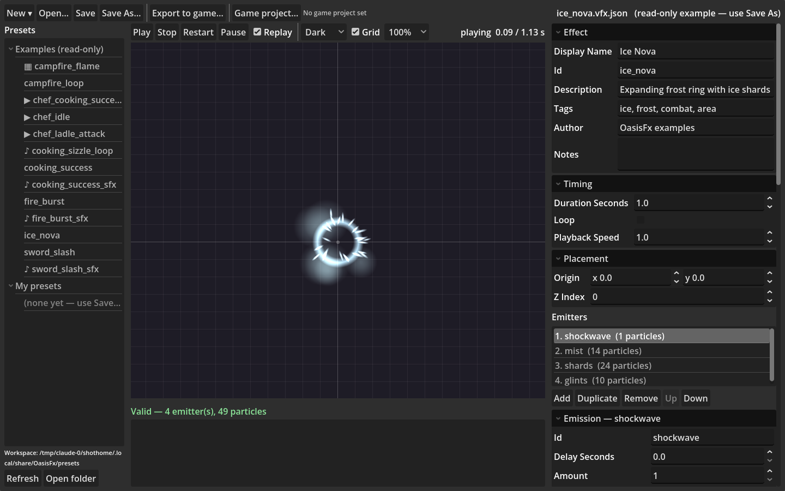

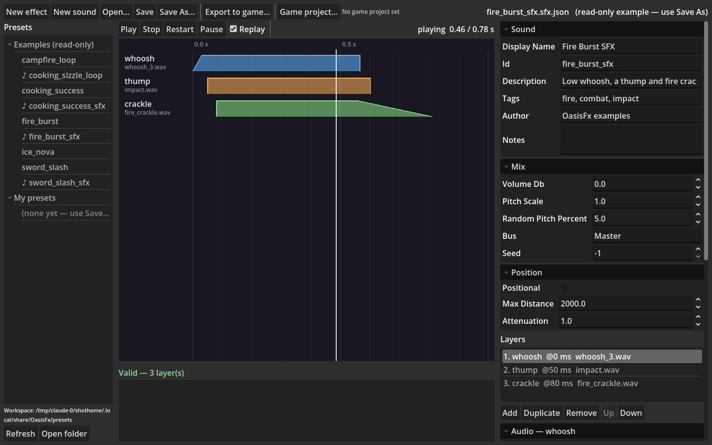

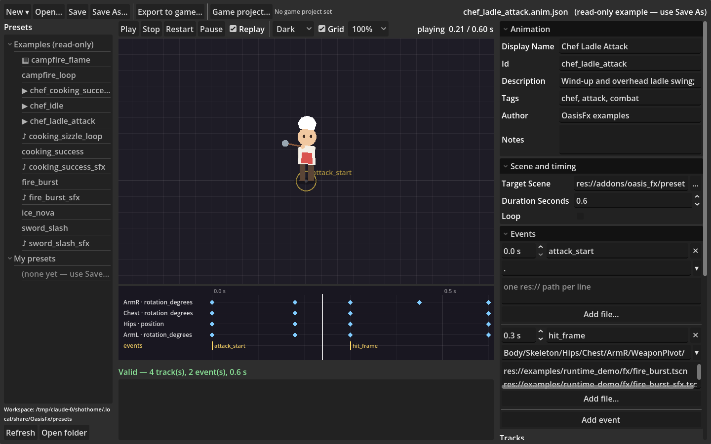

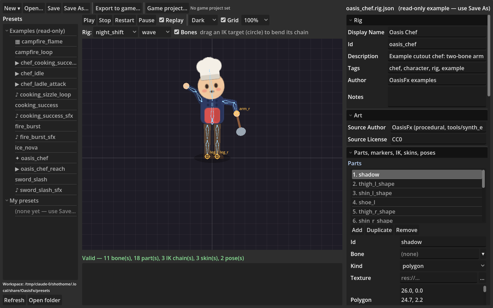

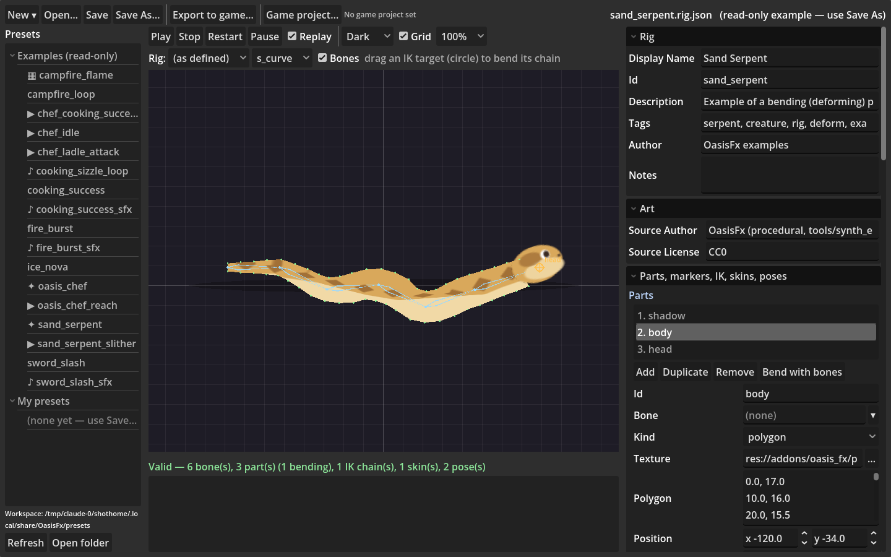

รายละเอียดและคำสั่งงานล่าสุดอยู่ใน [Spec v1.1](Godot_Asset_Studio_Claude_Code_Implementation_Spec.md)
และ [CLAUDE.md](CLAUDE.md) ซึ่งใช้แทนทิศทาง UI เดิมใน audit

## สถานะ

| Phase | เนื้อหา | สถานะ |
|---|---|---|
| 0 | สำรวจ repo และสภาพแวดล้อม ([AUDIT.md](AUDIT.md)) | ✅ เสร็จ |
| 1A | schema, loader, validator, CLI `validate`/`generate`, Fire Burst, headless tests | ✅ เสร็จ (แก้ test runner ตาม review แล้ว) |
| 1B | หลาย emitter (สูงสุด 8), preset ตัวอย่าง 5 แบบ, validate-all/generate-all, manifest, runtime lifecycle, demo, AI guide | ✅ เสร็จ |
| 1C | แอป Windows แยก: preset editor, preview, save/export และ Windows package | ✅ ทำแล้ว รอรับงาน (ยังไม่ได้ทดสอบบนเครื่อง Windows จริง) |
| 2 | SFX Composer: preset เสียงหลาย layer, runtime, timeline ในแอป, export เสียงเข้าเกม; 0.8.0: mixdown เป็น WAV | ✅ ทำแล้ว รอรับงาน (ยังไม่ได้ฟังเสียงจริง — cloud ไม่มีลำโพง) |
| 3 | Animation Timeline: keyframe ของ node ใน scene เดิม (bone, sprite, polygon), event ที่เรียก VFX/SFX, sprite frames, timeline + preview ในแอป | ✅ ทำแล้ว รอรับงาน (ยังไม่ได้ลองกับตัวละครจริงของ White Sahara — repo เกมไม่อยู่ใน session นี้) |
| 4 | Rigging: สร้าง/นำเข้า rig (Skeleton2D/Bone2D), ชิ้นส่วน PNG/polygon, marker, IK สองท่อน, skin, pose, ลาก IK ในแอป; 0.7.0: ชิ้นส่วนบิดงอตาม bone (weights) | ✅ ทำแล้ว รอรับงาน (ยังไม่ได้ลองนำเข้า mannequin จริงของ White Sahara; ไม่มีแปรงระบาย weight) |

## โครงสร้าง repo

```
project.godot          โปรเจกต์ของแอป (main scene = app/main.tscn) และ host สำหรับเทสต์ addon
addons/oasis_fx/       ตัว addon — copy โฟลเดอร์นี้ไปใส่เกมได้เลย
examples/runtime_demo/ เดโมการใช้ effect ในเกม + scene ที่ generate แล้ว (ใช้เป็น golden test)
tests/                 เทสต์ระดับ repo (แอป, เดโม และ golden files)
docs/images/           ภาพ preview ที่ render จริง
app/                   แอป desktop (main.tscn, ui/, services/, export/ = plugin ตอน build)
export_presets.cfg     การตั้งค่า export สำหรับ Windows และ Linux
tools/                 เครื่องมือสำหรับนักพัฒนา (render ภาพ preview, สังเคราะห์เสียง, วาด sprite sheet และชิ้นส่วน rig ตัวอย่าง)
AUDIT.md               รายงาน Phase 0
CLAUDE.md              คำแนะนำเริ่มงานและ milestone ปัจจุบัน
Godot_Asset_Studio_Claude_Code_Implementation_Spec.md   สเปกต้นฉบับ
```

## เริ่มใช้งาน

ต้องมี Godot 4.7.x (ทดสอบกับ 4.7.2-stable)

```bash
OASIS="godot --headless --path . --script res://addons/oasis_fx/cli/oasis_fx_cli.gd --"

# ตรวจ preset ทั้งโฟลเดอร์
$OASIS validate-all addons/oasis_fx/presets/examples

# สร้าง scene ทั้งหมด → res://generated/oasis_fx/<id>.tscn (+ oasis_fx_manifest.json)
$OASIS generate-all addons/oasis_fx/presets/examples

# รันเทสต์ทั้งหมด (addon + เทสต์ระดับ repo)
godot --headless --path . --script res://addons/oasis_fx/tests/run_tests.gd
```

ดู effect ทำงานจริง: เปิดโปรเจกต์ใน Godot → เปิด `examples/runtime_demo/runtime_demo.tscn` → กด F6
(คลิกซ้าย = Fire Burst, คลิกขวา = Ice Nova, Space = ฟันดาบ, C = ทำอาหาร, A = เชฟฟาดทัพพี, S = เชฟดีใจ,
R = rig เอื้อมคน (IK), K = เปลี่ยน skin, P = เปลี่ยน pose, G = เปลี่ยน skin ของงู — งูเลื้อยตลอดและลำตัวบิดงอตาม bone) — effect ที่มีเสียงคู่กันจะเล่นเสียงด้วย

ภาพหน้าจอจริงของเดโม (render ใน cloud ด้วย software OpenGL ผ่าน Xvfb):

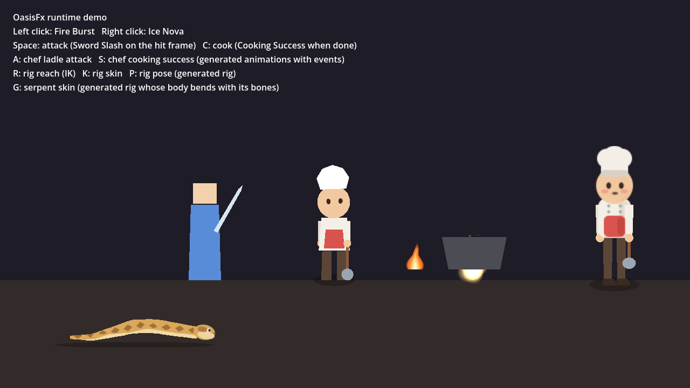

Preview ของ effect ตัวอย่าง (8 เฟรมตามเวลา สร้างด้วย `tools/render_preview.gd`):

| Effect | Preview |
|---|---|
| Fire Burst | 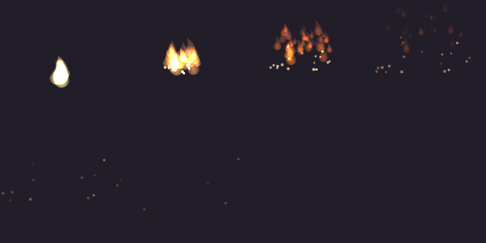 |
| Ice Nova | 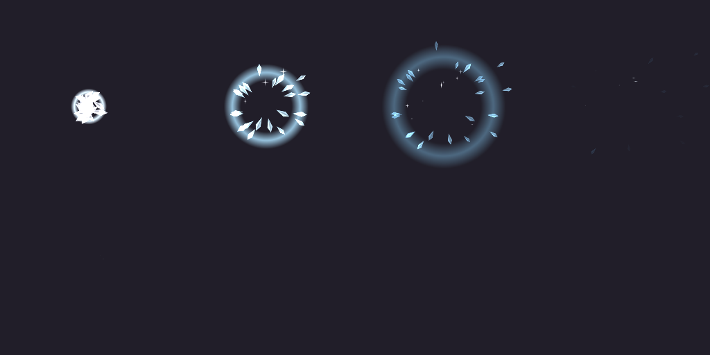 |
| Sword Slash | 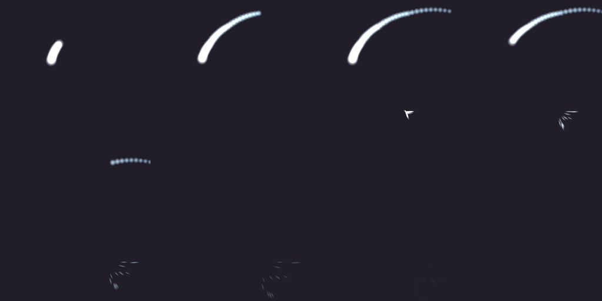 |
| Cooking Success | 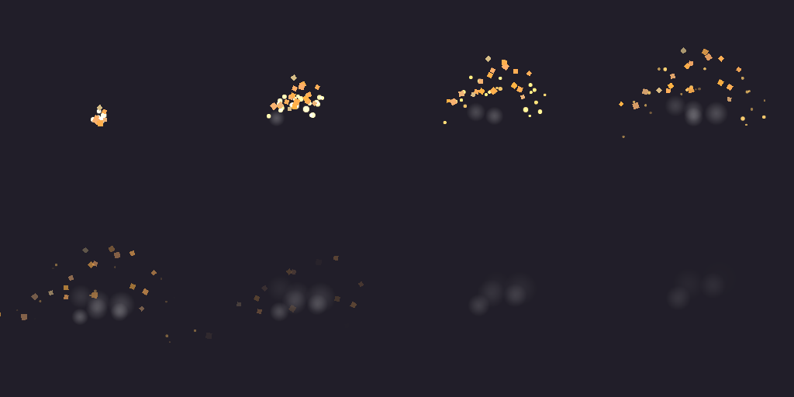 |
| Campfire Loop | 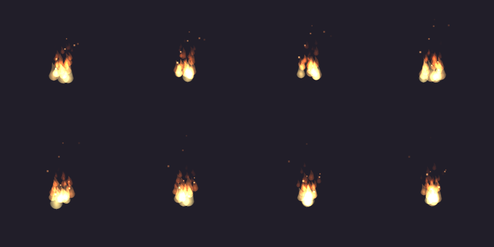 |

เอกสารละเอียด: [addons/oasis_fx/README.md](addons/oasis_fx/README.md),
[รูปแบบ preset](addons/oasis_fx/docs/preset_format.md), [CLI](addons/oasis_fx/docs/cli.md),
[รูปแบบ preset เสียง](addons/oasis_fx/docs/sfx_format.md),
[รูปแบบ animation และ sprite frames](addons/oasis_fx/docs/animation_format.md),
[คู่มือให้ AI เขียน preset](addons/oasis_fx/docs/ai_authoring_guide.md)

## ข้อจำกัดของ cloud session

- แอปที่ติดตั้งใน PC ของผู้ใช้ไม่ได้ถูกเรียกจาก cloud อัตโนมัติ; cloud ใช้ source/CLI และ Godot ใน session นั้น
- ไม่มี GPU: การทดสอบอัตโนมัติรันแบบ `--headless` (ตรวจโครงสร้างและการโหลด scene ได้ แต่ไม่ได้วาดภาพ)
- ภาพ preview สร้างได้ด้วย `tools/render_preview.gd` ผ่าน Xvfb + Mesa (software OpenGL)
  ใช้ดูหน้าตาคร่าว ๆ เท่านั้น ควรเช็กใน Godot Editor บนเครื่องจริงอีกครั้ง

## ผล review ของ Phase 1A

ที่ commit `4c6e7bf` รัน suite เดิมด้วย Godot 4.7.2 ได้ **41 passed, 0 failed**
และไม่พบ script error ใน suite เดิม แต่การทดลองแยกพบว่า test runner ยังพิมพ์ PASS และ exit 0
เมื่อ test เกิด runtime error ก่อนบันทึก assertion failure ได้

**แก้แล้ว:** runner ดักทุก script/engine error ด้วย `Logger` (`OS.add_logger`) แล้วนับเป็น test ล้มเหลว
มี timeout ต่อ test และมี regression `tests/test_runner.gd` (12 tests) ที่รันคำสั่ง runner จริงกับ test ตัวอย่าง
ที่ตั้งใจให้พัง ตอนจบงานแก้ review ผลรันทั้งหมดคือ **53 passed, 0 failed**

## Phase 1B

- **Schema v1 ขยายแบบเข้ากันได้ย้อนหลัง:** field ใหม่เป็น optional ทั้งหมด preset ของ 0.1 ยังใช้ได้เหมือนเดิม
  field ใหม่ ได้แก่ `delay_seconds`, `rotation_degrees`, `origin`, รูปทรง `circle_outline`/`ring`,
  `emission_offset`, `radial`/`tangential`/`orbit` velocity, `angle`, `angular_velocity`, `hue_variation`,
  texture `ring`/`streak`/`square`, `align_to_velocity`, `preprocess_seconds`
  ตัว schema ถูกสร้างจากตาราง field อัตโนมัติ และตรวจด้วย `jsonschema` ของ Python แล้ว
- **Runtime:** `OasisFxEffect` จัดการ delay, หยุด emitter ที่ duration, loop, restart/stop/pause และลบตัวเอง
  (ไม่แตะ node แม่)
- **CLI:** `validate-all` และ `generate-all` (ทำทั้งหมดหรือไม่ทำเลย), `schema`, manifest
  ถ้า OasisFx เองเกิด script error จะ exit 1 แทน 0
- **ผลเทสต์ล่าสุด: 86 passed, 0 failed** (exit 0) บน Godot 4.7.2 และได้ผลเดียวกันบนสำเนาใหม่ที่ไม่มี `.godot/`

## Phase 1C: แอป desktop

**เปิดจาก source:**
```bash
godot --path .
```

**Build สำหรับ Windows** (ต้องมี export templates 4.7.2):
```bash
godot --headless --path . --export-release "Windows Desktop" build/windows/OasisFx.exe
```
ได้ไฟล์ `OasisFx.exe` (~105MB, ฝังข้อมูลไว้ในไฟล์เดียว) และ `OasisFx.console.exe`

**สิ่งที่ทำได้ในแอป:**
- เปิดตัวอย่าง (อ่านอย่างเดียว) และ preset ของตัวเองใน workspace (`%APPDATA%\OasisFx\presets`)
- ปรับค่าด้วย control ที่มี type และช่วงค่าตรงกับ validator
- preview ทันที พร้อม Play/Pause/Stop/Restart, พื้นหลัง, grid และ zoom
- แสดง error/warning พร้อม path ของ field
- Save/Save As ในรูปแบบ canonical และถามก่อนทิ้งงานที่ยังไม่บันทึก

**Export เข้าเกม:**
- เลือกโฟลเดอร์ในโปรเจกต์เกม แอปหา `project.godot` เอง แล้วแสดงรายการไฟล์ที่จะเขียนก่อน
- ไฟล์ที่ได้เหมือนกับที่ CLI สร้างทุก byte ทั้งตอนรันจาก source และจาก build ที่แพ็กแล้ว
  (Phase 2 พบว่า build ที่แพ็กแล้วเขียน id เป็นตัวเลขและเขียนค่า default ด้วย — **แก้แล้วใน 0.5.1** ดูด้านล่าง)
- copy runtime script ให้เฉพาะเมื่อเกมยังไม่มี

**ผลการตรวจ:**
- เทสต์ทั้งหมด **116 passed, 0 failed**
- build Linux ที่แพ็กแล้วผ่าน `--smoke-test` และ export เข้าโฟลเดอร์ชื่อไทยได้
- scene ที่ export เปิดเล่นในโปรเจกต์แยกได้
- **NOT RUN:** การเปิด .exe บน Windows จริง, file dialog ของ Windows และ GPU จริง (มี checklist ให้ทดสอบเองใน [desktop.md](addons/oasis_fx/docs/desktop.md))

~~ยังไม่รองรับ export preset ที่ใช้ไฟล์ภาพ~~ → Phase 2 รองรับแล้ว ถ้าไฟล์อยู่ในโปรเจกต์เกม (ดูด้านล่าง)

## Phase 2: SFX Composer

preset เสียง (`<id>.sfx.json`) คือการ **เรียงไฟล์เสียงที่มีอยู่แล้ว** (wav/ogg/mp3) หลาย layer —
เริ่มเมื่อไร ดังเท่าไร pitch ตัดช่วงไฟล์ fade loop และสุ่มไฟล์/pitch/ความดังทุกครั้งที่เล่น
OasisFx ไม่ได้สร้างเสียงเองหรือดาวน์โหลดเสียง

```json
{"schema_version": 1, "asset_type": "sfx", "id": "sword_slash_sfx", "display_name": "Sword Slash SFX",
 "layers": [
   {"id": "whoosh", "source": "res://audio/whoosh_1.wav", "variants": ["res://audio/whoosh_2.wav"], "random_pitch_percent": 6, "source_license": "CC0"},
   {"id": "impact", "source": "res://audio/impact.wav", "start_ms": 140, "gain_db": -3, "source_license": "CC0"}]}
```

- **ได้อะไร:** `<id>.tscn` = `Node2D` + `AudioStreamPlayer`/`AudioStreamPlayer2D` ต่อ layer + runtime
  `OasisSfxEffect` (เล่นตาม offset, สุ่ม variant ไม่ซ้ำไฟล์เดิมติดกัน, fade, trim, loop, ลบตัวเองเมื่อจบ)
  ใช้ในเกม: `OasisSfxEffect.spawn(preload("res://sfx/sword_slash_sfx.tscn"), self, position)`
- **CLI เดิมทุกคำสั่งรองรับ `.sfx.json`:** `validate`, `validate-all`, `generate`, `generate-all`, `format`, `schema sfx`
- **schema:** `schemas/sfx.v1.schema.json` สร้างจากตาราง field `sfx_spec.gd` เหมือน VFX; VFX v1 ไม่เปลี่ยน
- **ตัวอย่าง 4 เสียง:** `sword_slash_sfx`, `fire_burst_sfx`, `cooking_success_sfx`, `cooking_sizzle_loop`
  ใช้ไฟล์เสียงที่สังเคราะห์เองด้วย `tools/synth_example_sounds.gd` (CC0) เดโมเล่นเสียงคู่กับ effect แล้ว
- **License:** ทุก layer มี `source_author`/`source_license` ถ้าว่างจะเตือน
- **แอป:** ปุ่ม *New sound*, timeline แสดง layer/fade/loop/playhead, เลือก **Game project…** แล้วปุ่ม **…**
  แปลงไฟล์ในเกมเป็น `res://` ให้อัตโนมัติ, export เข้าเกม: ไฟล์ที่เกมมีอยู่แล้ว = ใช้ (ไม่เขียนทับ),
  ไฟล์ตัวอย่างของ OasisFx = copy ให้ (พร้อมคำเตือน), ไฟล์ที่ไม่มีที่ไหนเลย = error
- **WAV mixdown:** ยังไม่ทำ ทดลองแล้วว่าเป็นไปได้ด้วย Movie Maker ของ Godot (ต้องมีจอ/Xvfb) — รายละเอียดใน sfx_format.md

**ผลการตรวจ Phase 2:**
- เทสต์ทั้งหมด **142 passed, 0 failed** (exit 0) และได้ผลเดียวกันบนสำเนาใหม่ที่ไม่มี `.godot/`
- preset ตัวอย่าง 9 ไฟล์ผ่าน JSON Schema ด้วย Python `jsonschema`
- build Linux/Windows ใหม่, Linux ผ่าน `--smoke-test` (preview เสียงและ export เสียงเข้าโฟลเดอร์ชื่อไทย)
- **NOT RUN:** ฟังเสียงจริง (ไม่มีอุปกรณ์เสียงใน cloud), เปิด .exe บน Windows, GPU จริง


## Phase 3: Animation Timeline

มี preset ใหม่ 2 แบบ:

| ชนิด | ไฟล์ | ได้อะไร | ใช้ทำอะไร |
|---|---|---|---|
| `animation` | `<id>.anim.json` | `<id>.tres` (Godot Animation) | ขยับ node ของ scene ที่มีอยู่แล้วในเกม (เช่น bone ของ Skeleton2D, sprite, polygon) ด้วย keyframe + **event** (hit_frame, footstep, cooking_complete) ที่เรียก VFX/SFX ของ OasisFx |
| `sprite_frames` | `<id>.frames.json` | `<id>.tres` (SpriteFrames) | ตัด animation แบบทีละเฟรมจาก sprite sheet ไปใช้กับ AnimatedSprite2D |

- **ไม่สร้าง/ไม่แก้ rig เดิม:** preset ชี้ไปที่ scene ของเกม (`target_scene`) และอ่านไฟล์ `.tscn` แบบ **ข้อความ**
  เพื่อตรวจว่า node path มีจริงและเป็นชนิดที่ถูกต้อง (ไม่โหลดหรือรัน script ใด ๆ) ถ้าพิมพ์ path ผิดจะบอก path ที่น่าจะใช่
- **ปลอดภัย:** property ที่ animate ได้มีแค่ position, rotation_degrees, scale, opacity, modulate, visible, frame, z_index
  และ event เรียกได้เฉพาะ method ตายตัว `OasisAnimationEvents.oasis_event()` ซึ่งแสดงได้เฉพาะ scene ที่ OasisFx สร้าง
- **Event เป็นแค่ภาพ/เสียง:** ไม่ตัดสินดาเมจ เกมฟัง signal `event_triggered` เองได้
- **ตัวอย่าง:** rig เชฟ (`presets/examples/rigs/chef_rig.tscn`) + animation 3 แบบ (idle วนลูป, ฟาดทัพพีพร้อมไฟและเสียงตอนโดน,
  กระโดดดีใจพร้อมประกาย) + sprite sheet เปลวไฟ CC0 ที่วาดด้วย `tools/synth_example_sprites.gd`
- **แอป:** เมนู *New ▾* มี Animation / Sprite frames; preview สร้างตัวแทนของ scene จากไฟล์ข้อความแล้วเล่น animation จริง,
  timeline แสดง track/key/event (คลิกเลือก track, ลากเพื่อดูท่า), แก้ key/event ได้, เลือก node จากรายการ,
  sprite frames แสดง sheet พร้อมกริดและเฟรมปัจจุบัน; export `.tres` เข้าเกมพร้อม effect ที่ event ใช้
- **โครงสร้างภายใน:** เพิ่ม registry ของชนิด asset (`asset_types.gd`) ให้ validator/schema/serializer/generator/CLI/แอป
  ใช้ร่วมกัน — schema และ golden ของ VFX/SFX ออกมาเหมือนเดิมทุก byte

**ผลการตรวจ Phase 3:**
- เทสต์ทั้งหมด **163 passed, 0 failed** (exit 0) และได้ผลเดียวกันบนสำเนาใหม่ที่ไม่มี `.godot/`
- preset ตัวอย่าง 13 ไฟล์ผ่าน JSON Schema ทั้ง 4 แบบด้วย Python `jsonschema`
- animation ที่สร้างเล่นบน rig จริงใน Godot (ท่า, event, effect เกิดที่ปลายทัพพี) และ export เข้าโปรเจกต์แยกแล้วเล่นได้
- build Linux/Windows ใหม่, Linux ผ่าน `--smoke-test` ครบทั้ง 4 ชนิด (export เข้าโฟลเดอร์ชื่อไทย), ภาพหน้าจอจริงอยู่ใน `docs/images/`
- **NOT RUN:** เปิด .exe บน Windows, ลองกับตัวละครจริงของ White Sahara, GPU จริง


## 0.5.1: export จากแอปที่แพ็กแล้วตรงกับ CLI ทุก byte

- เดิม Godot release build (แอปที่แพ็กแล้ว) ไม่รองรับ `set_id_for_path()` และไม่รู้ค่า default ของ script
  เลยเขียน id ของ ext_resource เป็นตัวเลขและเขียนค่า default ลงไปด้วย → สลับ export ระหว่างแอปกับ CLI แล้วขึ้น OVERWRITE
- ตอนนี้ generator จัดข้อความไฟล์เองหลังบันทึก (`normalize_saved_text()`): ใช้ id คงที่เรียงตาม id และตัด property ที่เท่าค่า default
  ออก ไฟล์จาก editor ไม่เปลี่ยน (golden ทั้งหมดเหมือนเดิม)
- **ตรวจแล้ว:** เทสต์ใช้ไฟล์จริงที่แอปแพ็กรุ่นก่อนเขียนไว้ (`tests/fixtures/release_build/`) แปลงแล้วตรงกับ CLI;
  `--smoke-test` ของ build Linux ที่แพ็กแล้วสร้างตัวอย่างทั้ง 13 ไฟล์ได้ตรงกับ CLI (`matches_cli: true`);
  ไฟล์ที่ export จากแอปแพ็กแล้วกับไฟล์ที่ CLI สร้างในเกมเดียวกันตรงกันทุก byte (4 ชนิด)
- เทสต์ทั้งหมด **164 passed, 0 failed (also on a fresh copy)**
- **NOT RUN:** เทียบแบบเดียวกันบน build Windows (ไม่มีเครื่อง Windows)

## Phase 4: Rigging (0.6.0)

preset ชนิดใหม่ `rig` (`<id>.rig.json` → `<id>.tscn`): ตัวละคร 2D แบบ cutout ที่ใช้ node มาตรฐานของ Godot
(`Skeleton2D`, `Bone2D`, `Sprite2D`, `Polygon2D`, `Marker2D`, IK สองท่อนใน modification stack, `AnimationPlayer`)

- **bone** เรียงจากพ่อไปลูก (ตำแหน่งเทียบกับ bone พ่อ), **part** เป็นรูป PNG หรือ polygon ติดกับ bone (แข็ง ไม่บิดงอ),
  ลำดับการวาดใช้ `z_index`, **marker** เป็นจุดบน bone (ปลายทัพพี มือ) ใช้เป็นที่เกิด effect ของ event
- **IK สองท่อน** (ขา/แขน): ขยับ `IKTargets/<chain>` แล้วข้อพับเอง; ทุก instance ได้ IK stack ของตัวเอง
  (Godot แชร์ stack ระหว่าง instance โดยปกติ ทำให้หลายตัวในฉากพัง — runtime แก้ให้แล้ว)
- **skin** เปลี่ยนรูป/สี/การแสดงของ part (`apply_skin("night_shift")`), **pose** ตั้งท่าทันที (`set_pose("wave")`)
- **นำเข้า rig เดิม:** `import-rig <scene.tscn> --out <file.rig.json>` หรือในแอป *New ▾ → Rig from a scene in the game…*
  อ่าน `.tscn` แบบข้อความ ไม่แก้ scene เดิม; สิ่งที่แปลงไม่ได้ (bone weight, IK เดิม, skew, region, animation, ชื่อที่เปลี่ยน)
  แจ้งเป็น note ทั้งหมด
- **ตัวอย่าง:** Oasis Chef (11 bone, 18 part, รูป PNG CC0 จาก `tools/synth_example_rig_parts.gd`, IK 3 ชุด, skin 3, pose 2)
  และ animation `oasis_chef_reach` ที่ขยับ IK target ของ rig ที่ generate แล้ว พร้อม event ที่ปลายทัพพี
- **แอป:** New ▾ → Rig / Rig from a scene; preview เป็น rig จริงพร้อมเส้น bone และ IK target ที่ลากด้วยเมาส์ได้,
  แถวเลือก skin/pose, inspector มี list editor สำหรับ parts/markers/IK/skins/poses (มีรายการ id ให้เลือก), export เข้าเกม
  พร้อม runtime และรูปชิ้นส่วน
- **ยังไม่ทำ (ตั้งใจ):** mesh deformation / bone weight, IK แบบอื่น (FABRIK/CCDIK), rig อัตโนมัติจากภาพเดียว

**ผลการตรวจ Phase 4:**
- เทสต์ทั้งหมด **179 passed, 0 failed** (exit 0) และได้ผลเดียวกันบนสำเนาใหม่ที่ไม่มี `.godot/`
- preset ตัวอย่าง 15 ไฟล์ผ่าน JSON Schema (rig ใหม่ + ผล import ของ `chef_rig.tscn`) ด้วย Python `jsonschema`
- import `chef_rig.tscn` แล้วสร้างใหม่ได้ตำแหน่ง/มุมของทุก bone, polygon และสีตรงกับต้นฉบับ (เทสต์)
- rig ที่ export เข้าโปรเจกต์แยก: 2 ตัวพร้อมกัน, skin, pose, animation + event ทำงาน, IK stack แยกกัน (เทสต์)
- build Linux/Windows ใหม่, Linux ผ่าน `--smoke-test` รวม rig (`matches_cli: true`, export เข้าโฟลเดอร์ชื่อไทย),
  ไฟล์ที่ export จากแอปแพ็กแล้ว 5 ชนิดตรงกับ CLI ทุก byte, ภาพหน้าจอจริงใน `docs/images/desktop_rig.png` และ `runtime_demo.png`
- **NOT RUN:** เปิด .exe บน Windows, นำเข้า `mannequin.tscn` จริงของ White Sahara (repo เกมไม่อยู่ใน session นี้), GPU จริง

## 0.7.0: ชิ้นส่วนบิดงอตาม bone (deformation)

- **ทดลองก่อน (spike):** GPU skinning ของ Godot (`Polygon2D.skeleton`) ใน renderer แบบ Compatibility
  (ที่แอปและโปรเจกต์นี้ใช้; ทดสอบด้วย Mesa llvmpipe) วาดจุดที่ผูกกับ bone ตัวที่ 2 เป็นต้นไปผิดตำแหน่ง แม้ในท่าปกติ
  → OasisFx จึง **ดัดจุดบน CPU** ใน `oasis_rig.gd` ทุกเฟรมด้วยสูตรเดียวกับ Godot (ทดสอบแบบ headless ได้ด้วย);
  ถ้าเกมใช้ GPU ที่ทำงานถูกต้อง ตั้ง `gpu_deform = true` ได้ (ยังไม่ได้ทดสอบบน GPU จริง)
- **field ใหม่ของ part (เพิ่มแบบ optional ใน schema v1 เดิม):** `weights` (bone + ค่า 0…1 ต่อจุด), `uv`,
  `internal_vertex_count`, `polygons` — เก็บในรูปแบบมาตรฐานของ Godot (`Polygon2D.bones`)
- **weight อัตโนมัติ:** `auto-weights <rig> --part ID [--bones a,b]` (CLI) หรือปุ่ม **Bend with bones** ในแอป —
  ผูกแต่ละจุดกับ bone ที่ใกล้ที่สุด 2 ตัวตามระยะ และย้าย part ไปที่ root โดยตำแหน่งไม่เปลี่ยน
- **นำเข้า:** `import-rig` เก็บ weight/uv/จุดภายใน/polygons ของ Polygon2D ที่ผูกกับ Skeleton2D (เดิมทิ้ง weight)
- **ตัวอย่าง:** Sand Serpent (ลำตัวมี texture 50 จุด ผูก 6 bone, หัวเป็น sprite, IK ที่คอ, skin สีซีด, 2 ท่า)
  + animation `sand_serpent_slither` (คลื่นวิ่งตามกระดูกสันหลัง, event "hiss")
- **แอป:** แก้ weight เป็นตัวเลขได้, ปุ่ม Bend with bones, preview บิดงอจริงและแสดงจุดเป็นสีเขียว

**ผลการตรวจ 0.7.0:**
- เทสต์ทั้งหมด **191 passed, 0 failed** (exit 0) และได้ผลเดียวกันบนสำเนาใหม่ที่ไม่มี `.godot/`
- เทสต์ตรวจตำแหน่งจุดหลังดัดเทียบกับสูตร (จุดบน bone เดียว, จุดที่ข้อต่อ, bone พ่อขยับ, rig อยู่ใต้ node ที่หมุน/ย่อขยาย),
  `auto-weights` ได้ผลตรงกับไฟล์ตัวอย่าง, นำเข้า scene ที่ใช้ skinning แล้วดัดได้เหมือนต้นฉบับ, export ไปโปรเจกต์แยกแล้วงูเลื้อยได้
- build Linux/Windows ใหม่, Linux ผ่าน `--smoke-test` (`rig_bending: true`, `matches_cli: true` ครบ 17 ตัวอย่าง)
- ภาพหน้าจอจริง: `docs/images/desktop_rig_bend.png`, `runtime_demo.png`
- **NOT RUN:** `gpu_deform` บน GPU จริง, เปิด .exe บน Windows, นำเข้า mannequin จริงของ White Sahara

## 0.8.0: Mixdown เป็น WAV และ GitHub CI

- **ทดลองก่อน:** `AudioStreamPlayback.mix_audio()` ของ Godot 4.7.2 ถอดรหัสเสียง wav/ogg/mp3 ได้แบบ offline ใน headless
  (ไม่ต้องมีการ์ดเสียงหรือหน้าจอ) → ใช้แทนแนวคิด Movie Maker เดิมที่ต้องมีหน้าจอ
- **mixdown:** `mixdown <sfx.json> --out <file.wav> [--variant N] [--seconds S] [--normalize]` หรือปุ่ม **Render WAV…** ในแอป
  ใช้กฎเวลาเดียวกับ runtime (เริ่มช้า, ตัดหัว, ความยาว, pitch, gain, fade, loop) → WAV 16-bit stereo
  เป็น "take เดียว" (ไฟล์ที่ N ของแต่ละ layer, ไม่สุ่ม pitch/volume); เสียงที่วนลูปต้องบอกความยาว (แอปใช้ 4 วินาที);
  รายงาน peak และจำนวน sample ที่ clip (`--normalize` ปรับ peak เป็น −1 dBFS; แอปทำให้อัตโนมัติเมื่อจะ clip)
- **ข้อสังเกต:** เสียงตัวอย่าง Sword Slash เมื่อ whoosh กับเสียงกระทบซ้อนกัน ดังเกิน 0 dBFS เล็กน้อย (~+0.7 dB) —
  ในเกมก็รวมเสียงแบบเดียวกัน
- **CI:** `.github/workflows/oasisfx.yml` — ดาวน์โหลด Godot 4.7.2 ทางการ ตรวจ SHA-256, import, `validate-all`,
  `format --check` และเทสต์ทั้งหมด ทุกครั้งที่ push ไป `main`/`claude/**` และทุก PR (ไม่ build ตัวติดตั้ง และไม่ทดสอบ GPU/เสียง/Windows)

**ผลการตรวจ 0.8.0:**
- เทสต์ทั้งหมด **198 passed, 0 failed** (exit 0) และได้ผลเดียวกันบนสำเนาใหม่ที่ไม่มี `.godot/`
- เทสต์ mixdown ด้วยเสียงทดสอบ (sine): ตำแหน่งเริ่ม, gain, pitch, trim, fade, loop, variant, normalize, clip, ผลเหมือนเดิมทุกครั้ง;
  ดูรูปคลื่นของเสียงตัวอย่างแล้วถูกต้อง (เสียงกระทบเริ่มที่ 140 ms)
- build Linux/Windows ใหม่, Linux ผ่าน `--smoke-test` (`sound_mixdown`, `rig_bending`, `matches_cli` เป็น true)
- GitHub Actions (run แรก [#1](https://github.com/nutchanon9/white-sahara-studio/actions/runs/38850508710) บน ubuntu-24.04):
  ผ่านทุกขั้น — import, `validate-all`, `format --check` และเทสต์ **198 passed, 0 failed**
- **NOT RUN:** ฟังไฟล์ WAV ที่ได้ (ไม่มีลำโพงใน cloud), เปิด .exe บน Windows

## 0.8.1: วัดประสิทธิภาพฝั่ง CPU (สเปก §12)

สเปกบอกให้ทดสอบ effect จำนวนมากพร้อมกัน "โดยเฉพาะตอนสู้มอนสเตอร์และทำอาหาร" และให้ทำ pooling / quality presets
**เฉพาะเมื่อการวัดบอกว่าจำเป็น** — รอบนี้คือการวัดนั้น

- ฉากทดสอบ `examples/runtime_demo/stress_scenario.gd` ใช้แต่ asset ที่ generate แล้ว: effect + เสียงต่อสู้เกิดเป็นระลอก,
  เตาทำอาหาร (ไฟ + เสียงวนลูป + ประกายทุก 1 วินาที), เชฟ rig เล่น animation IK และงูเลื้อย (ดัดบน CPU)
- เครื่องมือ `tools/benchmark_runtime.gd` จับเวลาช่วง process ของทุกเฟรม (headless = ไม่มีต้นทุน GPU)
- ผล (CPU 4 core, 10 วินาที): ฉากต่อสู้ปกติ เฉลี่ย **1.3 ms**/เฟรม (p95 2.1); ฉากหนัก (เชฟ 12, งู 12, effect 4 ตัวทุก 0.05 วินาที,
  สร้าง 834 effect + 568 เสียง) เฉลี่ย **3.2 ms** (p95 4.7, มีเฟรมกระตุกครั้งเดียว 34 ms) — ทุก effect/เสียงลบตัวเองหมด
- **ตัดสินใจ:** ยังไม่ทำ pooling และ quality presets (ฝั่ง CPU ไม่จำเป็น); ฝั่ง GPU วัดไม่ได้ใน cloud — **NOT RUN**
- **ปรับปรุง:** การดัดชิ้นส่วนใช้เฉพาะ bone ที่มีผลต่อแต่ละจุด และข้ามเมื่อ bone ไม่ขยับ → งู 1 ตัวจาก 89 µs เหลือ ~22–37 µs ต่อเฟรม
- เทสต์ใหม่ `test_busy_fight_and_cooking_scene_runs_clean` (ไม่มี error, ทุกอย่างลบตัวเอง, ไม่มี node ค้าง)
- เทสต์ทั้งหมด **199 passed, 0 failed** (รวมบนสำเนาใหม่ และจำลองขั้นตอน CI); GitHub Actions run [#3](https://github.com/nutchanon9/white-sahara-studio/actions/runs/38867219736): ผ่าน **199 passed, 0 failed**

## 0.8.2: แก้จาก code review

รีวิวโค้ดส่วน core, CLI และ services ของแอป เจอ 10 จุด (และเทสต์ใหม่เจอเพิ่มอีก 1) แก้ครบทุกจุด:

- **GDScript หยุดทำงานเมื่อเทียบค่าต่างชนิดกัน** (`int != bool`, `float != Vector2`, `"1" == 1.0`) — ค่าที่อ่านจากไฟล์ของผู้ใช้
  จึงต้องเช็คชนิดก่อน: `import-rig` พังกับ Sprite2D ที่ใช้ `hframes`/`region_enabled` และ Polygon2D ที่ตั้ง `texture_rotation`;
  แอปแก้ค่า field ที่ชนิดผิด (เช่น `"duration_seconds": "1"`) ไม่ได้; inspector พังเมื่อ bool เป็นข้อความ; manifest ที่ถูกแก้มือทำ generate พัง
- **`auto-weights`** อาจผูก bone เกิน 8 ตัว แล้วเขียนทับ preset ที่ถูกต้องด้วยไฟล์ที่ไม่ผ่าน → จำกัด 8 bone (เลือกตัวที่มีน้ำหนักมากสุด)
  และตรวจผลก่อนเขียนไฟล์ทุกครั้ง
- **import ตัวละครใหญ่:** รายการ node ที่เปลี่ยนชื่อทำให้ `notes` ยาวเกิน 2000 ตัวอักษร → ย่อใน preset (รายการเต็มยังอยู่ในรายงาน);
  เกินจำนวน bone/part/marker → แจ้ง error ชัดเจนแทนการเขียน preset ที่ใช้ไม่ได้
- **Windows CRLF:** เพิ่ม `.gitattributes` (LF เสมอ); `format --check`, การ export และ manifest ไม่นับความต่างของ line ending เป็นการแก้ไฟล์
- **อ่าน .tscn:** ข้อความหลายบรรทัด (เช่น `[center]...[/center]` ใน RichTextLabel) เคยถูกอ่านเป็น header/property
- **CLI:** option ที่ไม่ใช่ของคำสั่งนั้นเป็น usage error (exit 2) เช่น `generate --check` เดิมสร้างไฟล์โดยไม่เตือน
- ลบโค้ดซ้ำ/ไม่ได้ใช้ (หา res path ซ้ำใน vfx_builder, `scene_path_for`); ค่าคงที่เก่าใน `oasis_fx.gd` เก็บไว้เพื่อความเข้ากันได้

เทสต์ใหม่ `test_review_fixes.gd` (7) + เทสต์แอป 3 — **ทั้งหมดล้มเหลวกับโค้ดเดิม** (ตรวจแล้ว) และผ่านกับโค้ดใหม่;
เทสต์ทั้งหมด **209 passed, 0 failed** (รวมบนสำเนาใหม่และจำลองขั้นตอน CI)

## 0.8.3: รีวิวรอบสอง (runtime ในเกม + UI ของแอป)

รีวิวพบ 10 จุด: แก้ 9 จุด, อีก 1 จุด (one-shot ในเอฟเฟกต์วนลูปที่ยาวกว่ารอบจะข้ามบางรอบ) validator เตือนไว้อยู่แล้ว จึงไม่ต้องแก้

**Runtime (รันในเกมของผู้เล่น):**
- animation event ที่อ้าง scene ที่ instantiate ไม่ได้ เคยทำให้เกิด script error ระหว่างเล่นและ effect ถัดไปหาย → ข้ามพร้อมคำเตือน
- ย้ายโฟลเดอร์ addon ในเกม (เช่นไป `res://plugins/oasis_fx`) แล้ว effect จาก event หายหมด → รู้จัก runtime จากชื่อคลาสด้วย
- ตั้ง `playback_speed` หลัง `spawn()` เดิมเร่งแค่นาฬิกาแต่อนุภาคไม่เร่ง → ใช้กับ emitter ทันที

**แอป:**
- ยกเลิก Save As ที่มาจากหน้าต่าง "ยังไม่ได้บันทึก" แล้ว Save As ครั้งถัดไปจะสั่ง action เก่า (เช่นปิดโปรแกรม) → ล้างทิ้ง
- Save As ที่เติมนามสกุลให้ เคยเขียนทับ preset อื่นที่มีอยู่โดยไม่ถาม → ปฏิเสธพร้อมแจ้ง
- event ที่ `effects` เป็นข้อความแทน array ทำให้ inspector พัง; Pause ไม่หยุดการเล่นซ้ำอัตโนมัติที่รออยู่;
  รายการ ▾ ของ bone/part ไม่อัปเดตหลังเปลี่ยนชื่อ/เพิ่ม/ลบ (ตอนนี้โหลดตอนเปิดเมนู); Restart ของ sprite ไม่กลับไปเฟรม 0

เทสต์ใหม่ 8 ตัว (runtime 2 ใน `test_review_fixes.gd` ซึ่งรันในเกมแยกที่ย้าย addon แล้ว, แอป 6) — **ล้มเหลวทั้งหมดกับโค้ดเดิม**
และผ่านกับโค้ดใหม่; เทสต์ทั้งหมด **217 passed, 0 failed** (รวมบนสำเนาใหม่และจำลองขั้นตอน CI)

## License

MIT — ดู [LICENSE](LICENSE)
